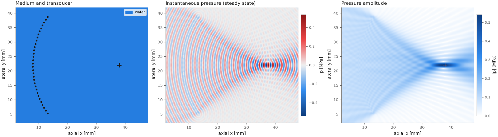
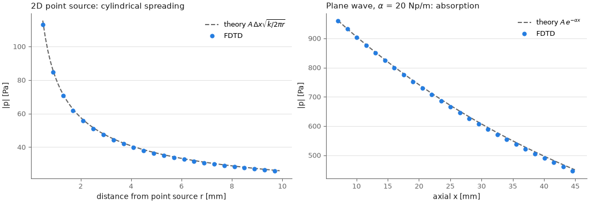
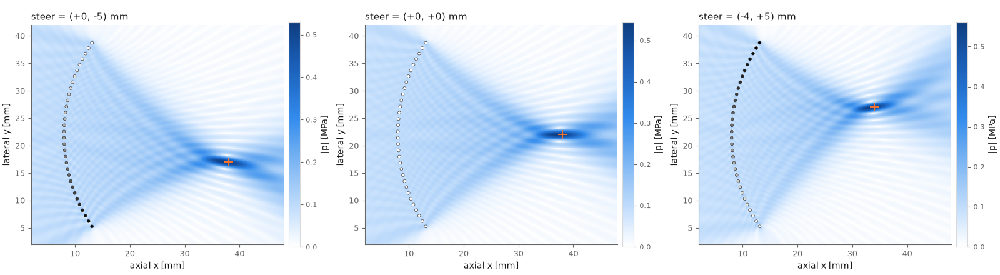
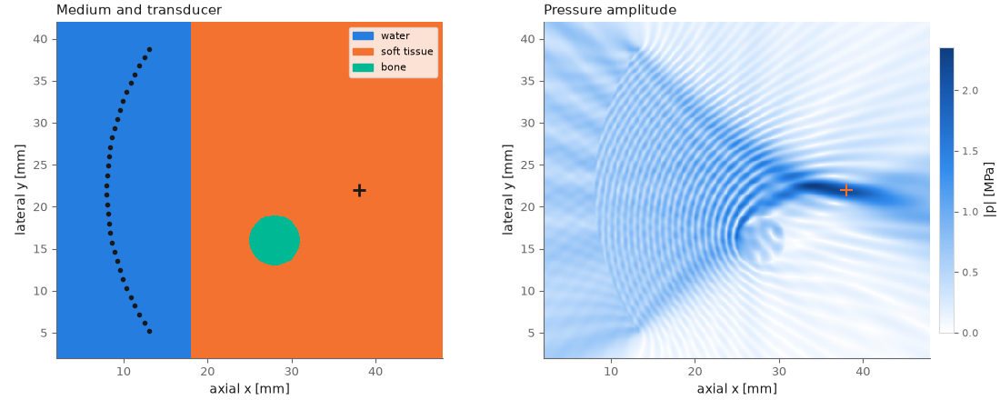
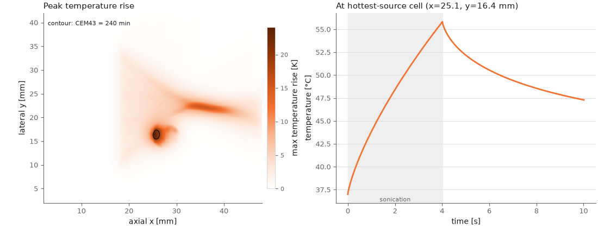
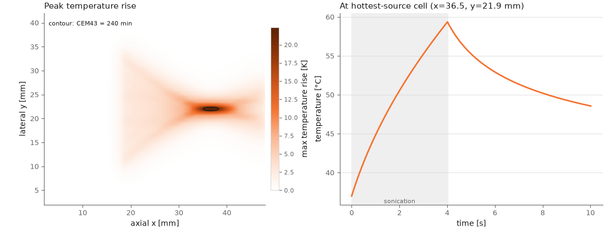

# hifu-sim

[](https://github.com/Shgabnaz1377/hifu-sim/actions/workflows/ci.yml)


**hifu-sim** simulates high-intensity focused ultrasound (HIFU) in heterogeneous tissue.
It is a small, tested Python package. A 2D finite-difference time-domain (FDTD) solver for
the linear acoustic wave equation computes the pressure field of a focused, electronically
steerable arc array. A Pennes bioheat solver then turns the absorbed acoustic power into a
temperature rise and a CEM43 thermal dose.



* **Physics:** linear acoustics with heterogeneous sound speed, density and attenuation
  maps; split-field perfectly matched layer (PML); arc transducer with per-element delays
  for steering; peak-pressure and intensity maps; Pennes bioheat equation and CEM43 dose.
* **Numerics:** staggered-grid leapfrog scheme (Yee/Virieux type), CFL-based time step,
  semi-implicit damping terms, and lock-in (single-bin DFT) extraction of steady-state
  amplitude and phase.
* **Performance:** fully vectorised NumPy kernel with no temporaries in the hot loop, plus an
  optional multithreaded Numba kernel. If Numba is not installed, the code falls back to
  NumPy with a warning.
* **Validation:** 74 pytest tests compare the solver with closed-form results: phase speed,
  absorption, reflection, cylindrical spreading, focal gain, focal width, PML energy decay,
  the CFL bound, Pennes and CEM43. The suite runs in 15 to 25 s.
* **Tooling:** typed `src/` package, YAML configs, a `hifu-sim` CLI, two executed example
  notebooks, and CI running ruff, mypy and pytest on Python 3.11 and 3.12.

---

## Physics

### Acoustics

The solver integrates the first-order linear acoustic equations for pressure $p$ and
particle velocity $\mathbf{u}$ in a medium with sound speed $c(\mathbf{x})$, density
$\rho(\mathbf{x})$ and amplitude attenuation $\alpha(\mathbf{x})$:

$$
\rho\,\frac{\partial \mathbf{u}}{\partial t} = -\nabla p ,
\qquad
\frac{\partial p}{\partial t} = -\rho c^2\,\nabla\cdot\mathbf{u} \;-\; \eta\,p \;+\; S(\mathbf{x},t),
\qquad \eta = 2\alpha c .
$$

Eliminating $\mathbf{u}$ in a homogeneous region gives the damped wave equation
$p_{tt} + \eta\,p_t = c^2\nabla^2 p$. For $\eta \ll \omega$ its plane-wave solution decays as
$e^{-\alpha x}$, with $\alpha = \eta/(2c)$. Tissue attenuation follows a power law
$\alpha(f) = \alpha_0 f^{y}$ (with $\alpha_0$ in dB cm⁻¹ MHz⁻ʸ). The power law is evaluated at the drive
frequency, which is appropriate for the narrow-band continuous-wave runs used here.

From the steady-state complex amplitude $\hat p$ the code reports

$$
I = \frac{|\hat p|^2}{2\rho c} \quad\text{(time-averaged plane-wave intensity)},\qquad
Q = 2\alpha I \quad\text{(absorbed power density)} .
$$

### Focused source

The transducer is a circular arc of radius $R$ (the 2D analogue of a spherical bowl). It
is centred on the geometric focus and split into $N$ elements. To steer to a target
$\mathbf{x}_t$, element $n$ fires with the delay

$$
\tau_n = \frac{\max_m |\mathbf{x}_m - \mathbf{x}_t| - |\mathbf{x}_n - \mathbf{x}_t|}{c_0},
$$

so all wavefronts arrive at $\mathbf{x}_t$ together. The source is an additive pressure
(mass) source. Its scaling comes from the 1D jump condition $p = S\,\Delta x/(2c)$, so a
straight row of source cells radiates a plane wave of exactly the requested amplitude $A$.
For the arc, the 2D Rayleigh integral gives the expected linear focal gain

$$
G = \frac{|\hat p(\text{focus})|}{A} = \frac{L}{\sqrt{\lambda R}}, \qquad L = 2R\theta
\;\text{(arc length)} .
$$

### Heating and thermal dose

The temperature follows the Pennes bioheat equation, with perfusion $w_b$ and blood
specific heat $c_b$:

$$
\rho C\,\frac{\partial T}{\partial t} = \nabla\cdot(k\nabla T) - w_b c_b\,(T - T_a) + Q .
$$

The thermal dose is expressed in cumulative equivalent minutes at 43 °C (Sapareto & Dewey):

$$
\mathrm{CEM43} = \sum_n R^{\,43 - T_n}\,\frac{\Delta t}{60},\qquad
R = \begin{cases} 0.5, & T \ge 43\,^\circ\mathrm{C}\\ 0.25, & T < 43\,^\circ\mathrm{C}\end{cases}
$$

A dose of 240 min is the threshold commonly used for thermal necrosis in soft tissue.

## Numerical method

| Item | Choice |
|---|---|
| Grid | Uniform Cartesian. $p$ sits at cell centres and $u_x, u_y$ on cell faces (staggered). Densities on faces are arithmetic means. |
| Time stepping | Leapfrog, second order in time and space |
| Stability | $c_{\max}\,\Delta t\,\sqrt{\Delta x^{-2}+\Delta y^{-2}} \le 1$, i.e. Courant number $< 1/\sqrt2$ for square cells (default 0.3). $\Delta t$ is snapped to a whole number of steps per period. |
| Absorbing boundary | Split-field PML, $p = p_x + p_y$, with $\sigma(d) = \sigma_{\max}(d/L)^3$ and $\sigma_{\max} = 4c\ln(1/R_0)/(2L)$. The PML sits inside the grid, 20 cells by default. |
| Damping terms | Crank–Nicolson on the decay terms, $a = (1-\sigma\Delta t/2)/(1+\sigma\Delta t/2)$. This is unconditionally stable for any $\sigma$ or $\eta$. |
| Source | Arc rasterised at $\Delta x/8$, with cell weights equal to the arc length inside the cell. Includes a $\cos(k\Delta x/2)$ correction for the discrete source response. |
| Steady state | Raised-cosine ramp, then a run of about 1.2 domain-diagonal transit times, then a lock-in over 4 whole periods |
| Thermal | Explicit finite-volume scheme with harmonic-mean face conductivities and Dirichlet $T = T_0$ on the outer boundary. $\Delta t$ comes from the diffusion and perfusion stability limit. |

Because the scheme is second order, it needs about 15 points per wavelength for
sub-percent phase-speed errors. The tests check this against the scheme's own discrete
dispersion relation $\sin(\omega\Delta t/2) = C\,\sin(k\Delta x/2)$.

## Validation

Every number below comes from the test suite (`tests/`) or from `scripts/make_figures.py`
on the grids used there.

| Check | Expectation | Result |
|---|---|---|
| CFL bound (`test_cfl.py`) | Stable at 0.98× the von Neumann limit, unstable at 1.03× | Bounded vs growth > 10⁶; invalid Courant numbers and `dt` values are rejected |
| PML energy decay (`test_pml.py`) | A Gaussian pulse leaves a 160² box | $E/E_0 = 9\times10^{-7}$ after 40 µs. A rigid box keeps $E/E_0 = 1.01$ |
| Plane-wave speed (`test_plane_wave.py`) | $c$ = 1500 and 2500 m/s, 15 points per wavelength | −0.67 % and −0.24 %, identical (to 5×10⁻⁴) to the discrete dispersion relation |
| Plane-wave amplitude | $A$ = 1000 Pa | 1000.3 Pa |
| Absorption, $\alpha$ = 20 Np/m | $e^{-\alpha\,\Delta x}$ = 0.670 over 20 mm | 0.665 (−0.8 %) |
| Water to bone-like interface | $R = (Z_2-Z_1)/(Z_2+Z_1)$ = 0.551, $T$ = 1.551 | 0.559, 1.559 |
| 2D point source (`test_analytic.py`) | $\lvert p\rvert = A\,\Delta x\sqrt{k/(2\pi r)}$ (Hankel far field) | Within 3 % at 3 to 7 mm in four directions; max error 1.2 % for r ≥ 3 mm |
| Focal gain (`test_focus.py`) | $L/\sqrt{\lambda R}$ = 4.28 | 4.19 (−2.0 %) at the geometric focus |
| Focal width | −6 dB width of $\lvert\int e^{iky\sin\varphi}d\varphi\rvert$ | Within 5 % |
| Focal position | Peak near the geometric focus | On axis. The peak sits 1.05 mm in front of the focus (expected focal shift) |
| Steering | +3 mm lateral target | Peak within 2 cells of the target, gain drops slightly |
| Pennes (`test_thermal.py`) | No losses: $\Delta T = Qt/\rho C$. Perfusion: $Q/(w_bc_b)\,(1-e^{-t/\tau})$. Diffusion: $\sigma^2 = \sigma_0^2 + 2\kappa t$ | Matches to $10^{-6}$, $10^{-3}$ and 3 %. Heat is conserved to 1 % |
| CEM43 | 1 min at 43/44/46/42 °C gives 1/2/8/0.25 min | Exact |
| Kernels (`test_kernels.py`) | Naive = NumPy = Numba | Identical up to round-off on a random heterogeneous medium |



## Example results

All three configs in [`configs/`](configs) run at 1 MHz on a 500 × 440 grid
(Δx = 0.1 mm, 15 points per wavelength), with a 70° arc, R = 30 mm and 32 elements.

| Config | Peak \|p\| | Peak position vs focus | −6 dB width (axial × lateral) | T<sub>max</sub> | Max CEM43 | Runtime (Numba) |
|---|---|---|---|---|---|---|
| `water.yaml` (A = 0.1 MPa) | 0.54 MPa (gain 5.44, theory 5.46) | −0.8 mm axial | 9.7 × 1.5 mm | – | – | 5.9 s |
| `tissue_layer.yaml` (A = 0.6 MPa) | 2.94 MPa | −1.4 mm axial | 9.4 × 1.5 mm | 59.4 °C | 950 min | 5.1 s |
| `bone_inclusion.yaml` (A = 0.6 MPa) | 2.36 MPa | −3.9 mm axial, +0.5 mm lateral | 9.5 × 1.7 mm | 61.1 °C (at the bone) | 2780 min | 9.6 s |

**Electronic steering.** The same array in water is steered to (0, −5), (0, 0) and
(−4, +5) mm. Dot shade shows the firing delay.



**Bone-like inclusion.** The bone has about 3.2× the impedance of soft tissue. It reflects a
large part of the beam (fringes in front of it), shadows the lower half of the aperture,
and weakens and shifts the focus. Because bone absorbs strongly, its surface heats more
than the target: the only region above 240 CEM43 is at the bone, not at the focus.




For comparison, here is the tissue-only case:



## Performance

Time for one leapfrog step (`python benchmarks/bench_kernels.py --sizes 64 128 256 512 1024`).
The machine was an Intel Core (14 logical CPUs, Numba using 14 threads) running Windows 11,
Python 3.12.10, NumPy 2.5.5 and Numba 0.68.1. Each value is the best of 3 runs.

| Grid | Naive loops [ms/step] | NumPy [ms/step] | Numba [ms/step] | NumPy vs naive | Numba vs NumPy |
|---|---|---|---|---|---|
| 64×64 | 10.1 | 0.0345 | 0.0492 | 292× | 0.7× |
| 128×128 | 33.5 | 0.0814 | 0.061 | 412× | 1.3× |
| 256×256 | – | 0.408 | 0.0985 | – | 4.1× |
| 512×512 | – | 2.98 | 0.543 | – | 5.5× |
| 1024×1024 | – | 15.6 | 3.34 | – | 4.7× |

Vectorisation alone is worth two to three orders of magnitude. Numba's multithreading pays
off from about 128² cells; below that, thread start-up costs more than it saves. End to end,
a full `water.yaml` run (220 k cells, 3015 steps) takes 11 s with NumPy and 6 s with Numba.
The remaining time goes to the per-step peak tracking and lock-in, which stay in NumPy.

## Installation

```bash
git clone https://github.com/Shgabnaz1377/hifu-sim.git
cd hifu-sim
python -m venv .venv && source .venv/bin/activate   # Windows: .venv\Scripts\activate
pip install -e ".[numba]"          # numba is optional but recommended
pip install -e ".[dev,notebooks]"  # tests, linters, notebook tooling
```

## Usage

### Command line

```bash
hifu-sim run configs/tissue_layer.yaml -o results/tissue
hifu-sim run configs/water.yaml --backend numpy --no-plots
hifu-sim info                      # backends and material library
python -m hifu_sim run ...         # same thing without the console script
```

A run writes:

* `<name>.npz`: every map (`pressure_amplitude`, `pressure_phase`, `peak_positive`,
  `peak_negative`, `intensity`, `heat_source`, `sound_speed`, `density`,
  `alpha_np_per_m`, `temperature_max`, `cem43`, …) plus the x and y axes;
* `<name>_metrics.json`: the resolved configuration and focal metrics;
* `<name>_acoustic.png`, `<name>_profiles.png` and `<name>_thermal.png`.

Configs are short YAML files, for example:

```yaml
grid:   {size: [0.050, 0.044], spacing: 1.0e-4}   # m
pml:    {thickness: 20}
medium:
  background: water
  regions:
    - {kind: layer,  material: soft_tissue, x_min: 0.018, x_max: 1.0}
    - {kind: circle, material: bone, center: [0.028, 0.016], radius: 0.003}
source: {frequency: 1.0e6, amplitude: 6.0e5, radius: 0.030, aperture_deg: 70,
         n_elements: 32, focus: [0.038, 0.022], steer: [0.0, 0.0]}
thermal: {enabled: true, heating_time: 4.0, cooling_time: 6.0}
```

### Python API

```python
import hifu_sim as hs

f0 = 1e6
grid = hs.Grid.from_size(0.05, 0.044, 1e-4)
medium = hs.Medium.from_regions(
    grid, "water",
    [hs.Region(kind="layer", material="soft_tissue", x_min=0.018, x_max=1.0)],
    frequency=f0,
)
array = hs.ArcTransducer(f0, radius=0.03, aperture_deg=70, focus=(0.038, 0.022),
                         amplitude=6e5, n_elements=32, steer=(0.0, 2e-3))

sim = hs.Simulation(grid, medium, f0, pml=hs.PML(20), cfl=0.3, backend="auto")
sim.add_source(array.to_source(grid, c0=1500.0))
field = sim.run_cw()                       # CWResult: amplitude, phase, peaks, intensity
print(hs.focal_metrics(field, array))

q = hs.absorbed_power_density(medium.alpha, field.intensity)
heat = hs.BioheatSolver(grid, medium).simulate(q, heating_time=4.0, cooling_time=6.0)
print(heat.temperature_max.max(), heat.cem43.max())
```

Lower-level pieces are public too: `Simulation.step()`, `record()` (pressure traces at
chosen points), `set_initial_pressure()` (initial-value problems), `energy()`,
`point_source()` and `plane_source()` with `cw_waveform()` or `gaussian_pulse()`.

### Notebooks

* [`examples/01_focusing_in_water.ipynb`](examples/01_focusing_in_water.ipynb): API tour,
  comparison with the diffraction integral, steering, and backend timing.
* [`examples/02_tissue_bone_heating.ipynb`](examples/02_tissue_bone_heating.ipynb): tissue
  and bone configs, the temperature rise, and the CEM43 lesion area.

Both run in under a minute on coarse grids. They are committed with their executed
outputs. `python scripts/make_figures.py` regenerates every figure in this README.

## Project layout

```
src/hifu_sim/   grid, medium, pml, source, kernels, solver, thermal, analysis, config, cli, plotting
tests/          validation tests (pytest)
configs/        water.yaml, tissue_layer.yaml, bone_inclusion.yaml
examples/       executed Jupyter notebooks
benchmarks/     naive vs NumPy vs Numba kernel benchmark
scripts/        make_figures.py (README figures + docs/figures/metrics.json)
docs/figures/   figures used in this README
```

## Limitations

This is a teaching and research-prototype code, **not** a treatment-planning tool.

* **2D only.** The arc focuses in a plane, so it behaves like a cylindrical (line-focus)
  transducer. Focal gains, intensities and temperatures are much lower than for a 3D
  spherical bowl of the same aperture and should not be compared with clinical numbers.
* **Linear acoustics.** There is no nonlinear propagation and no harmonic generation or
  shock formation. At the MPa focal pressures of the tissue examples, real HIFU fields are
  noticeably nonlinear, and nonlinear heating would be higher.
* **Fluid model.** Bone is treated as a fast, dense, lossy fluid. Shear waves and mode
  conversion are not modelled.
* **Absorption.** A single frequency-independent damping term, evaluated at the drive
  frequency, stands in for the power law. Dispersion from the power law is ignored.
* **Second-order FDTD** needs about 15 points per wavelength. Staircased interfaces and
  arc rasterisation add small errors. A pseudospectral or higher-order scheme would allow
  much coarser grids.
* **Thermal model.** Properties are constant (no temperature dependence, no perfusion
  shutdown), the outer boundary is held at the initial temperature, and the explicit time
  step is limited by diffusion.
* Material values are representative and rounded (see `MATERIALS` in `medium.py`), not
  patient-specific.

## References

* L. E. Kinsler, A. R. Frey, A. B. Coppens, J. V. Sanders, *Fundamentals of Acoustics*,
  4th ed., Wiley, 2000.
* A. D. Pierce, *Acoustics: An Introduction to Its Physical Principles and Applications*,
  Acoustical Society of America, 1989.
* T. L. Szabo, *Diagnostic Ultrasound Imaging: Inside Out*, 2nd ed., Academic Press, 2014.
* F. A. Duck, *Physical Properties of Tissue: A Comprehensive Reference Book*, Academic
  Press, 1990.
* A. Taflove, S. C. Hagness, *Computational Electrodynamics: The Finite-Difference
  Time-Domain Method*, 3rd ed., Artech House, 2005.
* K. S. Yee, "Numerical solution of initial boundary value problems involving Maxwell's
  equations in isotropic media," *IEEE Trans. Antennas Propag.* 14(3), 302–307 (1966).
* J. Virieux, "P-SV wave propagation in heterogeneous media: Velocity-stress
  finite-difference method," *Geophysics* 51(4), 889–901 (1986).
* J.-P. Berenger, "A perfectly matched layer for the absorption of electromagnetic waves,"
  *J. Comput. Phys.* 114(2), 185–200 (1994).
* B. E. Treeby, B. T. Cox, "k-Wave: MATLAB toolbox for the simulation and reconstruction of
  photoacoustic wave fields," *J. Biomed. Opt.* 15(2), 021314 (2010).
* H. T. O'Neil, "Theory of focusing radiators," *J. Acoust. Soc. Am.* 21(5), 516–526 (1949).
* H. H. Pennes, "Analysis of tissue and arterial blood temperatures in the resting human
  forearm," *J. Appl. Physiol.* 1(2), 93–122 (1948).
* S. A. Sapareto, W. C. Dewey, "Thermal dose determination in cancer therapy,"
  *Int. J. Radiat. Oncol. Biol. Phys.* 10(6), 787–800 (1984).
* G. ter Haar, C. Coussios, "High intensity focused ultrasound: Physical principles and
  devices," *Int. J. Hyperthermia* 23(2), 89–104 (2007).

## License

[MIT](LICENSE) © 2026 Shabnaz Ghaffari
